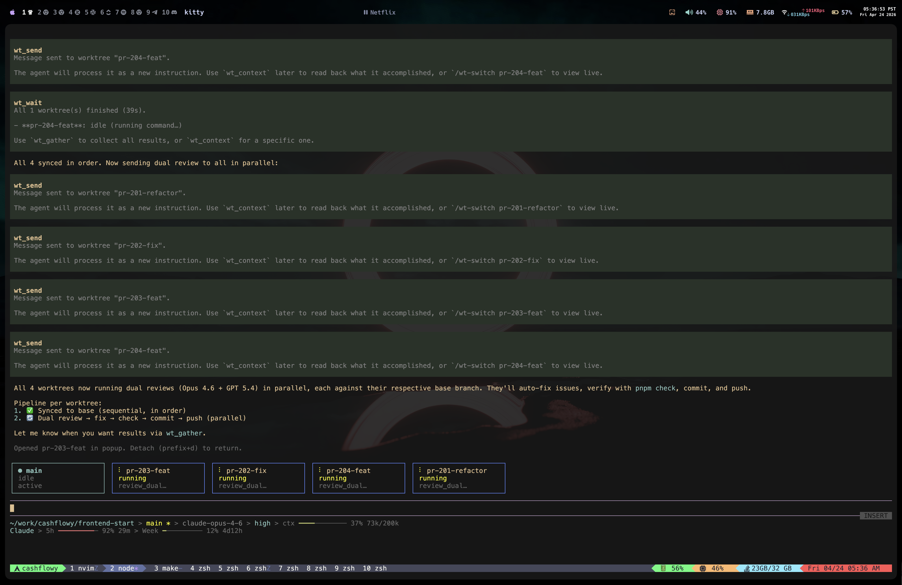
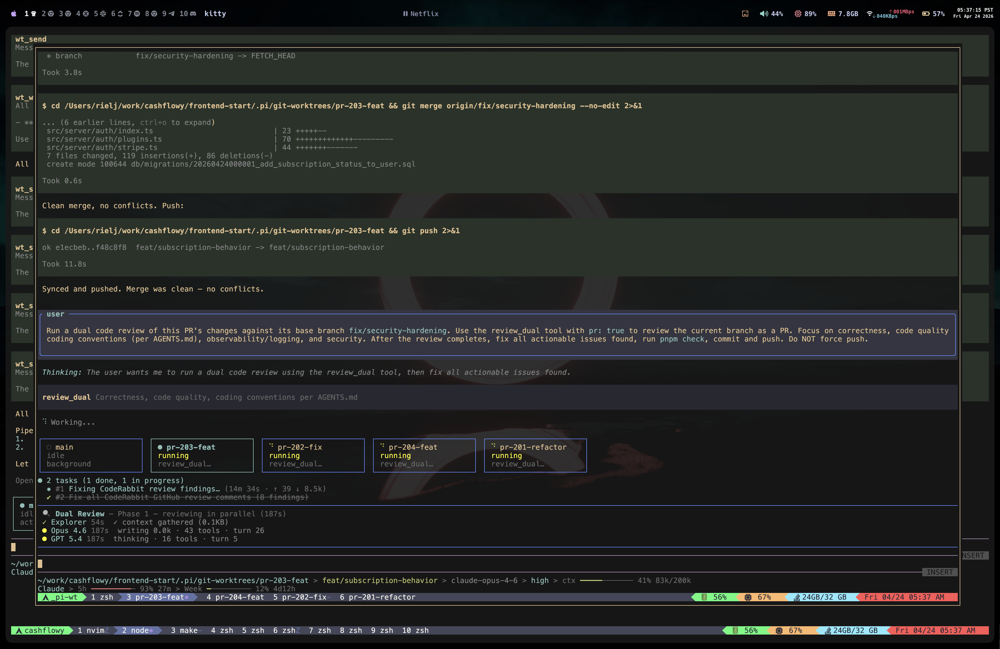

# pi-git-worktrees

Parallel AI agent sessions using git worktrees for [Pi](https://github.com/mariozechner/pi-coding-agent). Spawn multiple agents working on different tasks simultaneously — each in its own isolated git worktree — and orchestrate them from a single main session.



*Main session orchestrating 4 worktree agents — sending dual reviews to all in parallel, with live status widget showing each agent's activity.*



*Floating tmux popup showing a worktree agent running a dual code review, merging changes, and pushing — all autonomously.*

## Features

- **Parallel agent sessions** — Spawn multiple Pi agents, each in its own git worktree with a dedicated branch
- **Live status widget** — Horizontal boxes above your input show all worktrees, their status, and current activity
- **Tmux floating popups** — View and interact with any worktree agent via `tmux display-popup` — dismiss to return
- **Full orchestration** — Send instructions, wait for completion, gather results across all worktrees
- **Interactive panel** — `/worktrees` dialog with full keyboard navigation for managing all worktrees
- **Context sharing** — Pull compacted context from child worktrees back into main
- **Automatic cleanup** — Merge, archive, or remove worktrees with full file/branch/session cleanup
- **Heartbeat monitoring** — Real-time busy/idle detection across all worktree agents

## Requirements

- [Pi](https://github.com/mariozechner/pi-coding-agent) (latest)
- **tmux 3.2+** (required for floating popups and background sessions)
- **Git** (for worktree management)

## Installation

### From npm

```bash
npm install -g pi-git-worktrees
```

### From source

```bash
git clone https://github.com/rielj/pi-git-worktrees.git
cd pi-git-worktrees
npm install
```

### Enable the extension

Add to your Pi configuration. You can do this globally or per-project:

**Global** — `~/.pi/agent/extensions/` (symlink or copy):

```bash
# If installed globally via npm
ln -s $(npm root -g)/pi-git-worktrees/src/index.ts ~/.pi/agent/extensions/pi-git-worktrees.ts

# Or from source
ln -s /path/to/pi-git-worktrees/src/index.ts ~/.pi/agent/extensions/pi-git-worktrees.ts
```

**Per-project** — `.pi/extensions/`:

```bash
mkdir -p .pi/extensions
ln -s /path/to/pi-git-worktrees/src/index.ts .pi/extensions/pi-git-worktrees.ts
```

**Direct** (for testing):

```bash
pi -e /path/to/pi-git-worktrees/src/index.ts
```

## tmux Configuration

This extension requires tmux 3.2+ and uses `display-popup` for floating worktree views. Add the following to your `~/.tmux.conf`:

```tmux
# Required: allow popup windows (tmux 3.2+)
# The extension creates a hidden session named `_pi-wt` for worktree agents.
# No additional tmux config is strictly required, but these are recommended:

# Allow nested sessions (important for popup attach)
set -g allow-passthrough on

# Increase scrollback for worktree agents
set -g history-limit 10000

# Optional: keybinding to quickly list worktree windows
bind-key W display-popup -w 95% -h 95% -E "tmux attach -t _pi-wt"
```

After editing, reload tmux config:

```bash
tmux source-file ~/.tmux.conf
```

### How tmux is used

The extension manages a hidden tmux session called `_pi-wt`:

```
_pi-wt (hidden session)
├── window "fix-auth"     ← Pi agent running
├── window "add-tests"    ← Pi agent running
├── window "refactor-db"  ← Pi agent running
└── ...
```

- **Spawning** creates a new window in `_pi-wt` and runs Pi inside it
- **Viewing** opens a floating popup (`tmux display-popup`) that attaches to the window
- **Dismissing** the popup (detach with `prefix + d`) hides it — the agent keeps running
- **Sending messages** uses `tmux send-keys` to deliver text to the agent's input

Your own tmux sessions are never modified.

## Usage

### Slash Commands

| Command | Description |
|---------|-------------|
| `/worktrees` | Open the interactive worktree management panel |
| `/wt-new <task>` | Create a new worktree agent with a task |
| `/wt-switch <id>` | Open a worktree in a floating tmux popup |
| `/wt-send <id> <message>` | Send a message/instruction to a running worktree |
| `/wt-context <id>` | Import compacted context from a worktree into main |
| `/wt-merge <id>` | Merge a worktree's branch and archive it |
| `/wt-diff <id>` | Show diff of a worktree's changes |
| `/wt-remove <id>` | Delete a worktree and all associated files |

### LLM Tools

The agent can use these tools autonomously:

| Tool | Description |
|------|-------------|
| `wt_new` | Create a new worktree with its own Pi session |
| `wt_send` | Send a message/instruction to a running worktree agent |
| `wt_wait` | Wait for one or all worktrees to finish |
| `wt_gather` | Collect and compile context from all worktrees |
| `wt_context` | Retrieve compacted context from a specific worktree |

### Keyboard Shortcuts

| Shortcut | Action |
|----------|--------|
| `Ctrl+Shift+W` | Open worktrees panel |
| `Ctrl+Shift+]` | Switch to next worktree |
| `Ctrl+Shift+[` | Switch to previous worktree |

### `/worktrees` Panel

The interactive panel supports full keyboard navigation:

- `↑` / `↓` — Navigate between worktrees
- `←` / `→` — Switch between tabs (Worktrees / Actions / Settings)
- `Enter` — Activate selection
- `n` — Create new worktree
- `s` — Send message to selected worktree
- `d` — Remove worktree
- `m` — Merge worktree
- `c` — Import context
- `/` — Show diff
- `Esc` / `q` — Close panel

## Orchestration

The main session can orchestrate child worktrees using a fan-out / wait / gather pattern:

### 1. Dispatch work

```
> "Fix the auth bug, add API tests, and update the docs — use worktrees for each"

Agent calls:
  wt_new("fix auth bug",       branch: "fix/auth")
  wt_new("add API tests",      branch: "feat/api-tests")
  wt_new("update docs",        branch: "chore/docs-update")
```

### 2. Wait for completion

```
Agent calls:
  wt_wait()  →  polls heartbeats every 3s until all worktrees are idle
```

### 3. Gather results

```
Agent calls:
  wt_gather()  →  compiles context from all worktrees into a single report

Returns:
  # Worktree Gather Report
  ## fix-auth — Fixed token expiry check, 3 files changed
  ## api-tests — Added 12 tests covering all endpoints
  ## docs-update — Updated API reference and examples
```

### Send follow-up instructions

```
/wt-send fix-auth also add rate limiting to the login endpoint
```

Or let the agent do it:

```
> "Tell the auth worktree to also add rate limiting"

Agent calls:
  wt_send("fix-auth", "also add rate limiting to the login endpoint")
```

## Architecture

```
┌─────────────────────────────────────────────┐
│  Main Pi Session                            │
│                                             │
│  ┌─ Widget ──────────────────────────────┐  │
│  │ ● main    ∴ fix-auth   ∴ add-tests   │  │
│  │  idle      running      running       │  │
│  └───────────────────────────────────────┘  │
│                                             │
│  Tools: wt_new, wt_send, wt_wait,           │
│         wt_gather, wt_context               │
│                                             │
│  ┌─ Registry (.pi/wt-agents/registry.json)  │
│  │  Tracks all worktree metadata            │
│  └──────────────────────────────────────────│
│                                             │
│  ┌─ Heartbeat (~/.pi-git-worktrees/)        │
│  │  Live busy/idle detection via JSON files │
│  └──────────────────────────────────────────│
└───────────┬─────────────┬───────────────────┘
            │ tmux        │ tmux
            │ send-keys   │ send-keys
            ▼             ▼
┌───────────────┐ ┌───────────────┐
│ _pi-wt:fix-auth│ │ _pi-wt:add-tests│
│               │ │               │
│ Pi agent      │ │ Pi agent      │
│ Own branch    │ │ Own branch    │
│ Own worktree  │ │ Own worktree  │
│ Own session   │ │ Own session   │
└───────────────┘ └───────────────┘
```

## How It Works

1. **`wt_new`** calls `git worktree add` to create an isolated copy of the repo on a new branch
2. A Pi session file is created with the task seeded as the first user message
3. A new tmux window is spawned in the hidden `_pi-wt` session, running Pi with that session
4. The agent in the worktree starts working immediately on the seeded task
5. **Heartbeat files** (JSON, updated every 2s) let the main session detect busy/idle state
6. **`wt_send`** uses `tmux send-keys` to deliver follow-up instructions as user input
7. **`wt_wait`** polls heartbeats until all targeted worktrees are idle
8. **`wt_gather`** reads session files and extracts structured summaries
9. **`wt_merge`** runs `git merge` to bring changes back, then archives the worktree
10. **`wt_remove`** cleans up everything: git worktree, branch, session file, and registry entry

## Troubleshooting

### "tmux required for worktree switching"

Pi must be running inside tmux. Start your terminal session with:

```bash
tmux new-session
```

Then launch Pi inside the tmux session.

### "tmux 3.2+ required"

Check your tmux version:

```bash
tmux -V
```

If it's below 3.2, upgrade:

```bash
# macOS
brew install tmux

# Ubuntu/Debian
sudo apt install tmux
```

### Worktree agent appears dead but files exist

Run the cleanup command:

```bash
# Inside Pi
/worktrees
# Then use the panel to remove stale entries

# Or directly
/wt-remove <id>
```

The extension also runs `git worktree prune` automatically during reconciliation.

### Popup doesn't appear

Ensure `display-popup` is supported by your tmux version and terminal:

```bash
tmux display-popup -w 50% -h 50% -E "echo 'Popup works! Press Enter to close'; read"
```

If this doesn't work, your terminal may not support popup rendering.

## License

MIT
